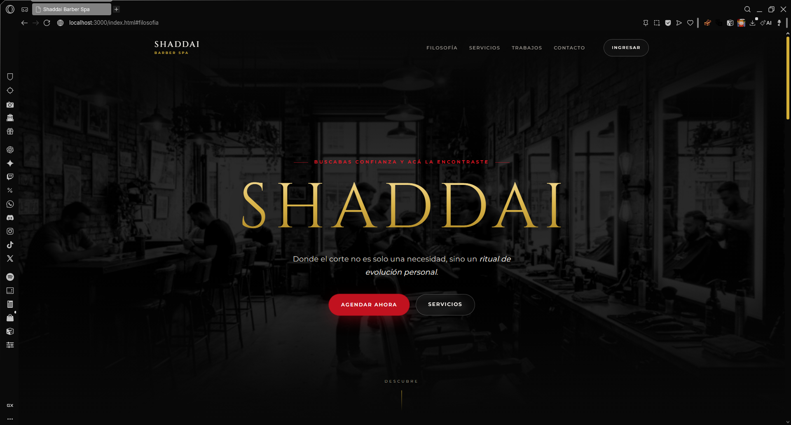

# Shaddai Barber Spa

Proyecto de sitio web para barbería con sistema de citas y gestión de cuenta (manejado en LocalStorage para fines académicos).
Los archivos jpg usados como complementos para el sitio fueron generados con IA, la barbería es distinta IRL

## Preview de la página



## Cuentas y citas (versión actual)

- Se guardan en `localStorage`: usuarios, sesión y citas.
- La contraseña se deriva con PBKDF2-SHA256 + salt cuando el navegador lo permite (o un respaldo simple si se abre con `file://`).
- **No es seguridad de producción.** Sirve para validar el producto; al migrar a Supabase se reemplaza `js/store.js` y `js/auth.js` manteniendo la misma interfaz.
- Las citas de la versión anterior (`shaddai-citas`) se pueden importar desde un aviso en `agenda.html`.

## Probar en local

Con cualquier servidor estático:

```bash
npx serve .
```

Abre `http://localhost:3000`. También funciona abriendo `index.html`, aunque conviene usar un servidor para que `crypto.subtle` esté disponible.

## Estructura

```text
css/
  variables.css   tokens de color, tipografía y medidas
  base.css        reset, botones, etiquetas y animaciones de entrada
  components.css  header, menú de usuario y footer
  home.css        hero, secciones, galería y contacto
  auth.css        login / registro
  app.css         panel de citas
js/
  data.js         contenido editable
  store.js        usuarios, sesión y citas (localStorage)
  auth.js         registro, login, logout y guard de rutas
  booking.js      stepper de reserva reutilizable
  home.js         render de servicios, galería y contacto
  cuenta.js       formularios de cuenta
  agenda.js       panel de citas
  ui.js           header, menú móvil, sesión visible y animaciones
```
